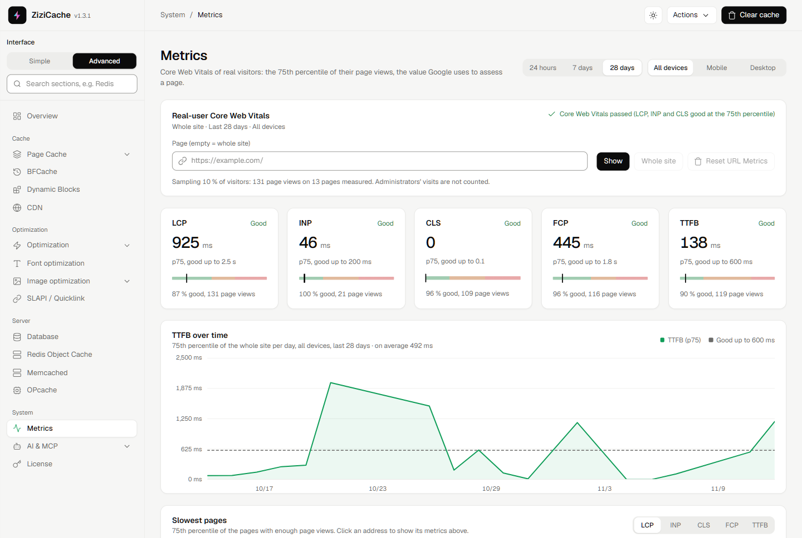
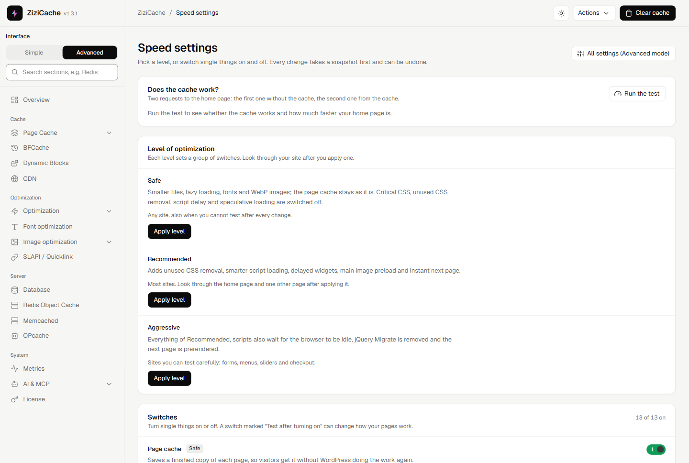
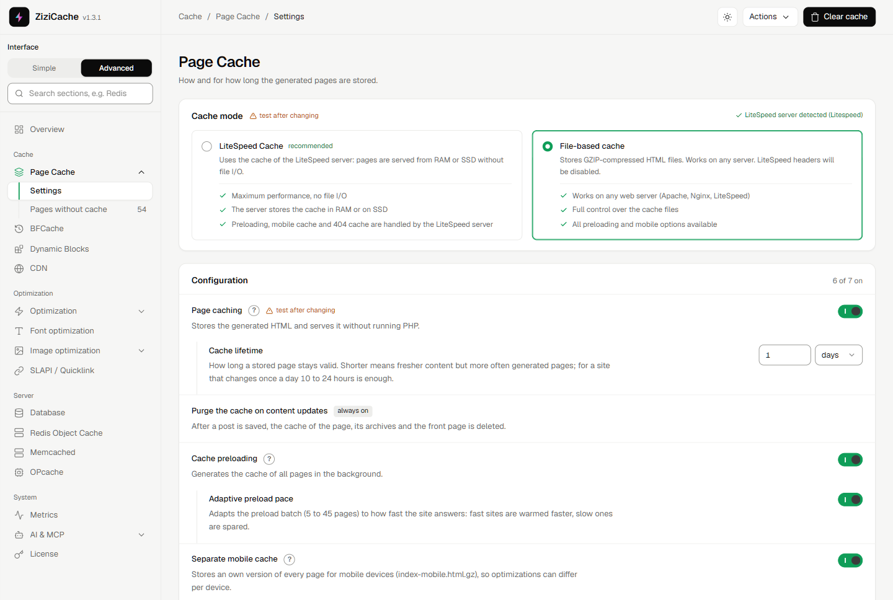
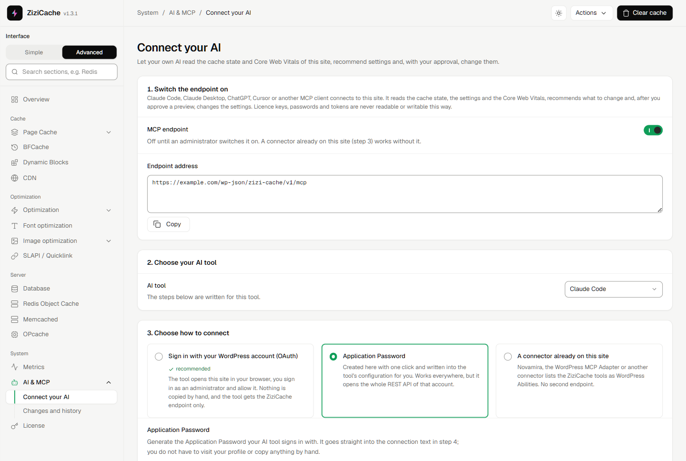
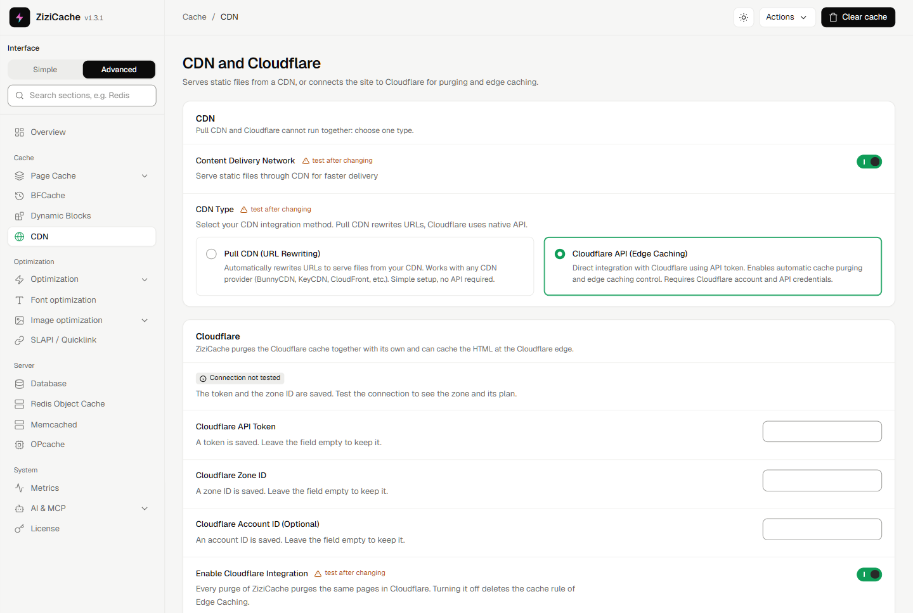

# ZiziCache

**WordPress caching and Core Web Vitals optimization. Set It. Cache It. Done.**

Page cache, LiteSpeed cache mode, Cloudflare edge cache, CSS, JavaScript, image and font optimization, 
Core Web Vitals of real visitors and an AI assistant connection (MCP) in one plugin.

[Website](https://zizicache.com) &nbsp;|&nbsp; [Documentation](https://zizicache.com/docs/) &nbsp;|&nbsp; [Features](https://zizicache.com/zizicache-features/) &nbsp;|&nbsp; [Pricing](https://zizicache.com/zizicache-pricing/) &nbsp;|&nbsp; [Changelog](CHANGELOG.md)

<picture>
  <source media="(prefers-color-scheme: dark)" srcset="assets/screenshots/metrics-dark.png">
  
</picture>

Core Web Vitals of real visitors on a production site, measured by ZiziCache itself (p75, last 28 days).

> This repository holds the public changelog, documentation links and issue tracker of ZiziCache.
> The plugin itself is distributed from [zizicache.com](https://zizicache.com) and updates itself from the WordPress admin.

## Why ZiziCache

- **One plugin instead of five.** Page cache, object cache, CSS and JavaScript optimization, image conversion, fonts, CDN and monitoring work together and know about each other.
- **Built for real hosting.** Native LiteSpeed cache mode on LiteSpeed and OpenLiteSpeed, compressed file cache on Apache and Nginx, a CPU budget for the preload on shared hosting and CloudLinux.
- **Shops stay fast while people buy.** Cart, checkout and account pages are never cached, a saved product purges only what changed, and shoppers with a cart still get cached pages.
- **Measured on your visitors.** LCP, TTFB and long animation frames come from real visitors, per page and per device, not from a single lab run.
- **Safe by default.** Three presets (Safe, Recommended, Aggressive) with a preview of every change, settings history with undo, and a self test that tells you why a page is not cached.

## Features

| Area | What you get |
| --- | --- |
| **Page cache** | File based cache (gzip) or native LiteSpeed cache, smart purge of related pages, preload with a CPU budget, separate mobile cache, cached 404 pages, query string rules. [Docs](https://zizicache.com/doc/page-cache/) |
| **Cloudflare and CDN** | Cloudflare edge cache rules through the API, targeted purges, emergency failover, pull CDN URL rewriting. [Docs](https://zizicache.com/doc/cdn-cloudflare/) |
| **CSS** | Minify, Critical CSS, Used CSS (removes unused CSS) with async loading of the original stylesheets. [Docs](https://zizicache.com/doc/css-optimization/) |
| **JavaScript** | Minify, defer or delay all scripts, delayed chat and social widgets, consent banner handling. [Docs](https://zizicache.com/doc/javascript-cookie-banners-external-scripts/) |
| **Images** | AVIF and WebP conversion on upload or in bulk, LCP image preload and fetchpriority, above-the-fold detection, lazy loading, missing width and height, thumbnail cleanup. [Docs](https://zizicache.com/doc/image-converter-avif-webp/) |
| **Fonts** | Self-hosted Google Fonts, subsets, preload of the fonts that really render, font-display strategy. [Docs](https://zizicache.com/doc/fonts/) |
| **Instant navigation** | Speculation Rules (prefetch, prerender), Quicklink, Back/Forward Cache, Early Hints 103. [Docs](https://zizicache.com/doc/speculative-loading-quicklink/) |
| **Dynamic Blocks** | Cache the full page and fill in the cart, prices, currency, user menu and nonces after load. [Docs](https://zizicache.com/doc/dynamic-blocks/) |
| **Server** | Redis (with ACL) and Memcached object cache, OPcache tools, database cleanup and index recommendations, multisite. [Docs](https://zizicache.com/doc/redis-memcached-opcache/) |
| **Metrics** | Core Web Vitals of real visitors (LCP, TTFB, LoAF) per URL and device, with attribution. [Docs](https://zizicache.com/doc/metrics-real-visitors/) |
| **AI assistant (MCP)** | Connect Claude, ChatGPT, Cursor or any MCP client: it reads the cache state and Core Web Vitals, suggests settings and changes them only after you approve a preview. [Docs](https://zizicache.com/doc/connect-ai-assistant-mcp/) |
| **Developers** | WP-CLI commands, REST API, hooks and filters, settings reference. [Docs](https://zizicache.com/doc/wp-cli-commands/) |

## Screenshots

Light or dark, the admin follows your choice. The screenshots below follow your GitHub theme.

<table>
<tr>
<td width="50%"><picture><source media="(prefers-color-scheme: dark)" srcset="assets/screenshots/simple-mode-dark.png"></picture> <b>Simple mode.</b> Test the cache, pick a level, every change is snapshotted and can be undone.</td>
<td width="50%"><picture><source media="(prefers-color-scheme: dark)" srcset="assets/screenshots/page-cache-dark.png"></picture> <b>Page cache.</b> LiteSpeed or file-based cache, adaptive preload, separate mobile cache.</td>
</tr>
<tr>
<td width="50%"><picture><source media="(prefers-color-scheme: dark)" srcset="assets/screenshots/ai-dark.png"></picture> <b>AI and MCP.</b> Your own AI reads the cache state and Core Web Vitals and changes settings only after your approval.</td>
<td width="50%"><picture><source media="(prefers-color-scheme: dark)" srcset="assets/screenshots/cdn-dark.png"></picture> <b>CDN and Cloudflare.</b> Pull CDN URL rewriting or the Cloudflare API with HTML edge caching and purges.</td>
</tr>
</table>

## Works with

**Servers:** LiteSpeed, OpenLiteSpeed, LiteSpeed Enterprise, Apache, Nginx, CloudLinux shared hosting 
**CDN:** Cloudflare (edge cache, APO purge), any pull CDN 
**Shops:** WooCommerce and currency switchers (WOOCS/FOX, WCML, Aelia, VillaTheme) 
**Languages:** WPML, Polylang, TranslatePress, Weglot, NagataPress 
**Page builders:** Elementor, Divi, Bricks, Oxygen, Breakdance, Beaver Builder, WPBakery, Kadence, the Site Editor and [more](https://zizicache.com/doc/woocommerce-currencies-page-builders/) 
**Object cache:** Redis, Memcached

## Getting started

1. Start the [21-day free trial](https://zizicache.com/zizicache-pricing/) and download the ZIP.
2. In WordPress open **Plugins > Add New Plugin > Upload Plugin**, install the ZIP and activate it.
3. The page cache is on right away. Open **ZiziCache > Speed settings**, preview the **Recommended** preset and apply it.
4. Check that pages come from the cache: the response header `x-zizi-cache-cache: HIT` ([how](https://zizicache.com/doc/requirements-and-installation/)).

Requirements: PHP 8.2 or newer, WordPress 6.9 or newer (tested up to 7.1).

## Documentation

| Start here | Optimize | Server and hosting | Developers |
| --- | --- | --- | --- |
| [Installation](https://zizicache.com/doc/requirements-and-installation/) | [CSS](https://zizicache.com/doc/css-optimization/) | [LiteSpeed mode](https://zizicache.com/doc/litespeed-cache-mode/) | [WP-CLI](https://zizicache.com/doc/wp-cli-commands/) |
| [Admin tour](https://zizicache.com/doc/admin-tour/) | [JavaScript](https://zizicache.com/doc/javascript-cookie-banners-external-scripts/) | [Shared hosting](https://zizicache.com/doc/shared-hosting-cloudlinux/) | [REST API](https://zizicache.com/doc/rest-api-reference/) |
| [Presets](https://zizicache.com/doc/presets/) | [Images and LCP](https://zizicache.com/doc/lazy-loading-lcp-above-the-fold/) | [Apache and Nginx](https://zizicache.com/doc/apache-nginx-htaccess/) | [Hooks and filters](https://zizicache.com/doc/hooks-and-filters/) |
| [Recommended setups](https://zizicache.com/doc/recommended-setups-by-site-type/) | [Fonts](https://zizicache.com/doc/fonts/) | [Cloudflare](https://zizicache.com/doc/cdn-cloudflare/) | [Settings reference](https://zizicache.com/doc/settings-reference-cache/) |
| [Why is a page not cached?](https://zizicache.com/doc/why-page-not-cached/) | [Instant navigation](https://zizicache.com/doc/speculative-loading-quicklink/) | [Multisite](https://zizicache.com/doc/multisite/) | [AI and MCP](https://zizicache.com/doc/connect-ai-assistant-mcp/) |

All articles: **[zizicache.com/docs](https://zizicache.com/docs/)**

## Changelog

Every release is listed in [CHANGELOG.md](CHANGELOG.md) and on [zizicache.com/changelog](https://zizicache.com/changelog/).

## Support and feedback

- Found a bug? [Open an issue](https://github.com/ffscz/zizicache/issues/new/choose) with your ZiziCache, WordPress and PHP version and the [self test](https://zizicache.com/doc/self-test-diagnostics/) result.
- Questions and ideas: [Discussions](https://github.com/ffscz/zizicache/discussions) or the [contact form](https://zizicache.com/contact/).
- Security reports: please use the [contact form](https://zizicache.com/contact/), not a public issue ([policy](SECURITY.md)).

If ZiziCache made your site faster, a star on this repository helps other WordPress users find it.

ZiziCache is commercial software by FFS.cz. This repository contains documentation only.
